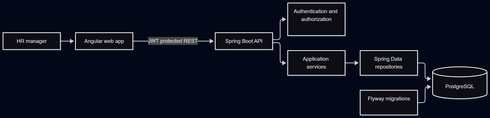
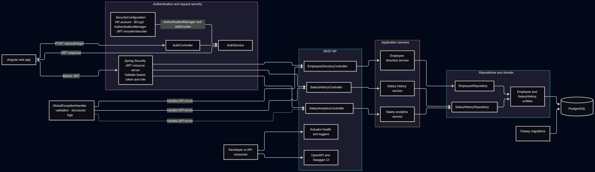
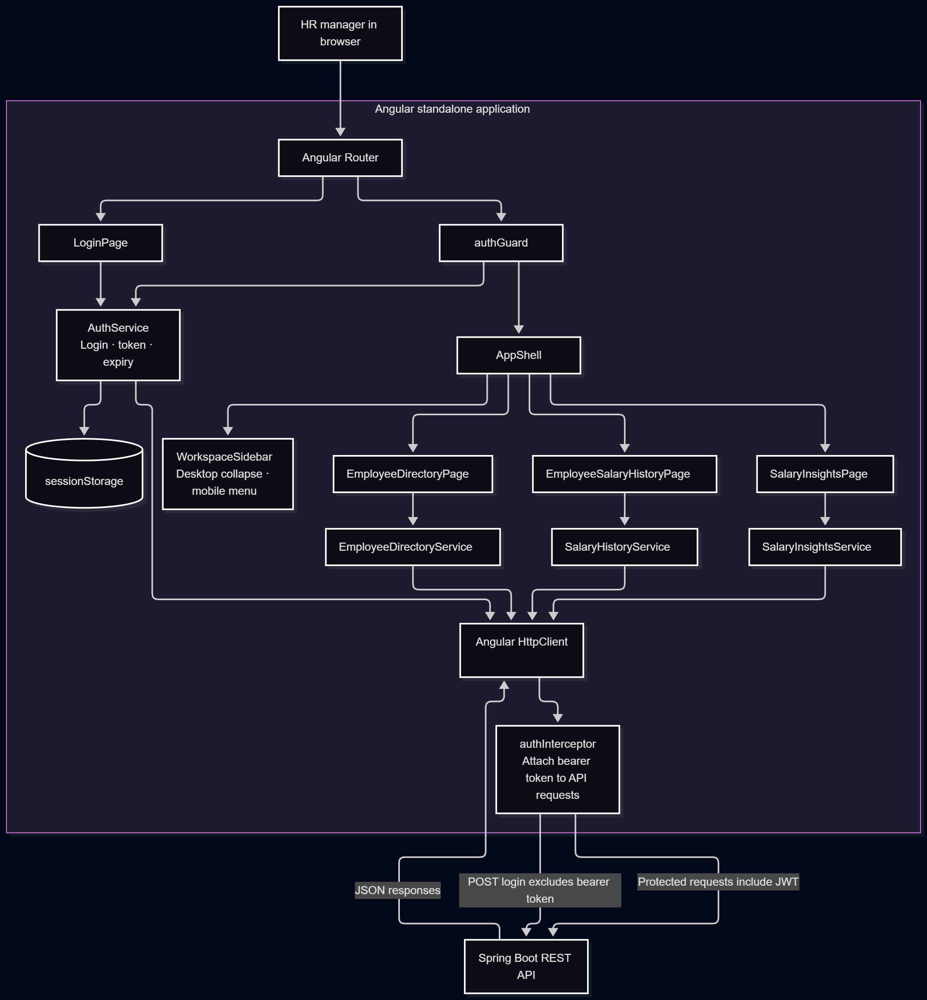

# ACME Salary Management

A full-stack salary management assessment project for an HR manager. It replaces spreadsheet-based employee salary tracking with a searchable employee directory, auditable salary history, and salary distribution insights for 10,000 fictional employees.

## Features

- HR manager sign-in with a signed JWT and protected API routes.
- Searchable, filterable, paginated employee directory.
- Salary history by employee, with effective dates and change attribution.
- Salary insights by country, department, and currency, with average, median, minimum, maximum, and total annual base salary.
- Responsive Angular workspace with desktop sidebar collapse and a mobile navigation menu.
- API documentation through Swagger UI.
- PostgreSQL schema migrations managed by Flyway and an idempotent demo-data seed script.

## Stack

- **Frontend:** Angular 22, Angular Material, TypeScript
- **Backend:** Java 21, Spring Boot 4, Spring Security, Spring Data JPA
- **Database:** PostgreSQL 18
- **Migrations:** Flyway

## Architecture

### High-level overview



### Backend



See the [backend diagram source and notes](docs/architecture/backend-architecture.md).

### Frontend



See the [frontend diagram source and notes](docs/architecture/frontend-architecture.md).

The backend keeps API, application, domain, and repository responsibilities in separate packages. Salary analytics are computed in PostgreSQL and returned as grouped aggregates; the UI does not fetch all employee salary records to calculate them.

## Local setup

### Prerequisites

- Java 21
- PostgreSQL 18 (or a compatible PostgreSQL release)
- Node.js and npm

### 1. Create the database

Create a PostgreSQL database named `salary_management` and a login role for the application. Choose a local password and use the same value in the backend configuration; do not put real credentials in committed files.

```sql
CREATE ROLE salary_app LOGIN PASSWORD 'set-a-local-password';
CREATE DATABASE salary_management OWNER salary_app;
```

The backend applies Flyway migrations on startup. Configure local database credentials, the HR manager password, and the JWT signing secret using environment variables or an ignored `application-local.yaml` file. The JWT secret must contain at least 32 bytes. Never commit real credentials or signing keys.

PowerShell example (set these in the terminal where the backend will run):

```powershell
$env:SPRING_DATASOURCE_URL = 'jdbc:postgresql://localhost:5432/salary_management'
$env:SPRING_DATASOURCE_USERNAME = 'salary_app'
$env:SPRING_DATASOURCE_PASSWORD = '<your local database password>'
$env:HR_MANAGER_USERNAME = 'hr-manager'
$env:HR_MANAGER_PASSWORD = '<your local HR manager password>'
$env:APP_SECURITY_JWT_SECRET = '<a random secret with at least 32 bytes>'
```

### 2. Start the backend and create the schema

From `backend/salary-management-api`:

```powershell
.\mvnw.cmd spring-boot:run
```

On first startup, Flyway creates the tables. Keep this terminal running while using the app. Swagger UI is available at `http://localhost:8080/swagger-ui/index.html`.

### 3. Seed 10,000 demo employees

After the first backend startup has created the schema, run this from `backend/salary-management-api` in another terminal:

```powershell
psql -h localhost -U salary_app -d salary_management -f scripts/seed-demo-data.sql
```

The script inserts 10,000 fictional employees and an initial salary record for each employee. It is safe to run again; existing employee numbers and effective-date entries are skipped.

### 4. Start the frontend

From `frontend`:

```powershell
npm.cmd install
npm.cmd start
```

Open `http://localhost:4200`. In PowerShell, the `.cmd` suffix avoids the script execution policy issue with `npm.ps1` and `ng.ps1`. The local UI calls the API at `http://localhost:8080`.

Sign in with the HR manager username and password configured for your local backend. No demo password is included in the repository.

## API overview

| Method | Endpoint | Purpose |
| --- | --- | --- |
| `POST` | `/api/auth/login` | Authenticate the HR manager and return a JWT |
| `GET` | `/api/employees` | Search, filter, and paginate employees |
| `GET` | `/api/employees/{employeeId}/salary-history` | Read salary history, newest effective date first |
| `POST` | `/api/employees/{employeeId}/salary-history` | Record a salary change |
| `GET` | `/api/analytics/pay-distribution` | Aggregate salary metrics by country, department, and currency |

Salary insights use the latest salary effective on or before the requested date and include active employees. Currency groups remain separate; the application does not convert amounts between currencies.

## Build and tests

From `backend/salary-management-api`:

```powershell
.\mvnw.cmd test
```

From `frontend`:

```powershell
npm.cmd test -- --watch=false
npm.cmd run build
```

The current suites pass with 24 backend tests and 7 frontend tests.

## Demo walkthrough

1. Sign in as the configured HR manager.
2. Search or filter the employee directory and open an employee.
3. Review their salary history and record a new salary with an effective date.
4. Open Salary Insights, choose an as-of date, and filter by country or department.
5. Resize the viewport to check the desktop sidebar collapse and mobile navigation menu.

## Assessment artifacts

- [Draft product requirements](docs/Salary_Management_Draft_Requirements.docx)
- Frontend coding guidance: [frontend/AGENTS.md](frontend/AGENTS.md)

## Scope and assumptions

- Salary means annual base salary; bonus, equity, payroll processing, and tax calculations are out of scope.
- The assessment uses one configured HR manager account rather than user registration or a full identity provider.
- Demo employees and salary amounts are synthetic and intended for local evaluation.
- Salary amounts in different currencies are not combined or converted.
