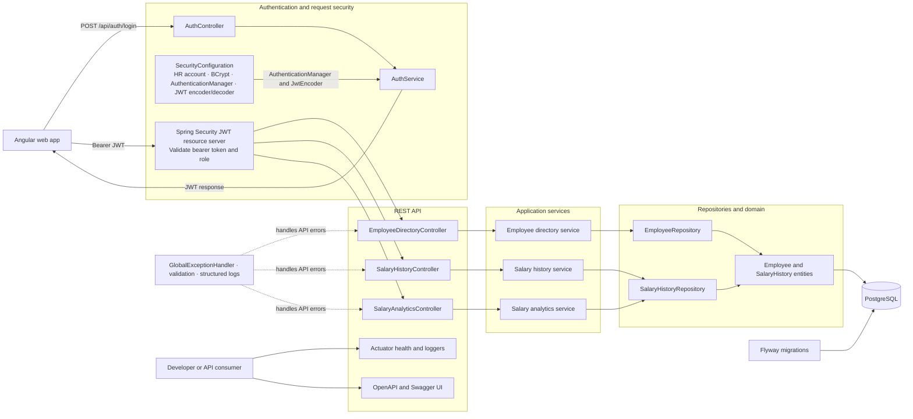

# Backend architecture

This diagram expands the Spring Boot portion of [`salary-management.png`](../../salary-management.png) into its API, security, application, persistence, and operational responsibilities.

## Responsibilities

- **API controllers** handle HTTP contracts and map requests and responses.
- **Application services** enforce use cases such as validating salary changes and generating as-of-date analytics.
- **Repositories and entities** persist employee and effective-dated salary history data. The analytics repository performs database-side aggregation.
- **Security configuration** authenticates the configured HR manager and validates JWT bearer tokens for protected routes.
- **Flyway** creates and evolves the relational schema. The demo seed script is separate from production migrations.
- **Cross-cutting facilities** provide consistent API errors, validation, logs, health/diagnostic endpoints, and generated API documentation.
