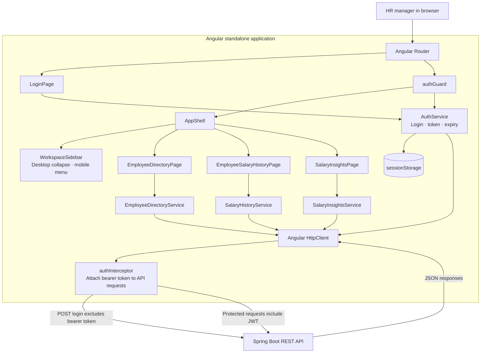

# Frontend architecture

This diagram expands the Angular portion of [`salary-management.png`](../../salary-management.png), showing routing, authentication state, feature pages, and the API boundary.

## Responsibilities

- **Router and guard** load feature pages lazily and protect the `/app` workspace using the current session.
- **AppShell and WorkspaceSidebar** provide shared navigation, including a collapsible desktop sidebar and a mobile navigation menu.
- **AuthService** performs login and stores the access token with its locally calculated expiry in session storage.
- **Feature pages** own page state and user interactions; feature data-access services keep endpoint calls separate from view code.
- **HTTP interceptor** attaches the bearer token to same-origin API calls, excluding the login request and unrelated origins.
